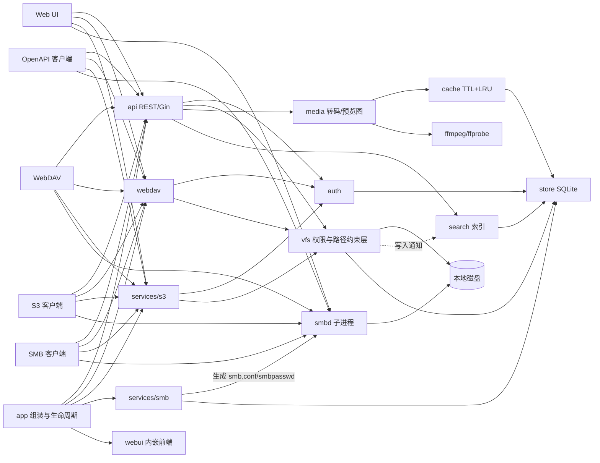

# MList

局域网文件管理系统：把服务器上的目录按用户授权，通过 **Web / WebDAV / S3 / SMB / REST API** 访问；
内置视频实时转码串流（HLS，可任意拖动进度）、预览图生成与缓存生命周期管理、模糊搜索。

后端 Go（Gin）+ SQLite（纯 Go 驱动，无 CGO），前端 Vue 3 + Naive UI，构建后打包成**单个可执行文件**。

## 功能

- **文件管理**：浏览（列表 / 网格）、新建、重命名、移动、复制、删除、下载；拖放 / 多文件上传队列。
- **在线预览**：图片、视频、音频、PDF、文本 / 代码（可编辑）；视频支持多音轨与内嵌 / 外挂字幕。
- **实时转码串流**：浏览器无法直接播放的视频（MKV、HEVC、AVI…）实时转为 HLS，**分片按需生成，可随意拖动进度**；
  支持原画 / 1080p / 720p / 480p 与硬件编码。
- **预览图与缓存治理**：自动生成多尺寸缩略图；预览图与转码分片分别设保留时长与容量上限（LRU 淘汰）；
  缓存以文件内容为标识（大小 + 首尾各 64 KiB 的哈希），移动、重命名或更换挂载目录都不会让预览失效；
  相同内容的文件共用缓存。
- **用户与权限**：管理员按目录授权并设置**只读 / 可读写**，所有协议共用同一套检查。
- **访问令牌**：带 `read` / `write` 范围与有效期的 API 令牌（`ml_` 前缀），明文加密存储、可随时在设置中再次查看；
  「API 文档」页面内嵌 Apifox 在线文档。
- **协议与挂载**：WebDAV（`/dav`）、S3 兼容接口（每个授权目录一个 bucket）、SMB（托管 Samba）。
- **模糊搜索**：常驻内存的文件名索引，fzf 风格子序列匹配打分，只返回当前用户有权访问的文件。
- 深色模式，桌面与移动端自适应。

## 快速开始（Docker，推荐）

镜像已发布在 GitHub Container Registry（公开，无需登录即可拉取），支持 linux/amd64 与 linux/arm64：

```bash
docker pull ghcr.io/sakana-1314/mlist:latest

docker run -d --name mlist \
  -p 8080:8080 -p 9000:9000 -p 445:445 \
  -v mlist-data:/data \
  -v /srv/media:/media \
  ghcr.io/sakana-1314/mlist:latest
```

镜像名必须**全小写**。标签：`latest`、`main`、`sha-<短提交>`，版本标签 `1.2`、`1.2.3`。

- `8080` Web / REST API / WebDAV，`9000` S3，`445` SMB。
- 默认账户 `admin` / `admin123`，**首次登录后立即改密码**，再到「用户管理」授权 `/media` 下的目录。
- 容器默认以 root 运行（`smbd` 监听 445、自动创建 SMB 系统账户都需要 root）；不用 SMB 时可用普通用户运行。
- 内置配置 `/etc/mlist/config.yaml`，可挂载自己的覆盖：`-v ./config.yaml:/etc/mlist/config.yaml:ro`。

数据保存在 `/data`（数据库、密钥、Samba 状态），请务必持久化并纳入备份。

## 从源码构建

需要 Go（版本见 `server/go.mod`）、Node.js 20.19+ / 22.12+ 与 pnpm 10（构建 Vite 8 前端）；
ffmpeg / ffprobe 与 libheif / libvips 为可选项（缺失时对应功能自动禁用），Samba 仅在 Linux 上用于 SMB。

```bash
cd server
make all                              # = make web（pnpm install && pnpm build）+ make build
cp config.example.yaml config.yaml
make run                              # 或 ./bin/mlist -config config.yaml
```

浏览器打开 `http://<服务器IP>:8080`。其它目标：`make test`（`go test -race ./...`）、`make vet`、
`make dist`（交叉编译 linux/amd64、linux/arm64、darwin/arm64、windows/amd64）、`make clean`。
版本号取自 `git describe`，可用 `make build VERSION=1.2.3` 指定。

开发模式：终端 1 运行 `cd server && go run ./cmd/mlist`；终端 2 运行 `cd web && pnpm install && pnpm dev`
（前端热更新，`/api` 与 `/dav` 代理到 `127.0.0.1:8080`）。未构建前端时后端仍可运行。

自建镜像（构建上下文是**仓库根目录**）：`docker build -f server/Dockerfile -t mlist .`

### 镜像体积

基础镜像基于 **Alpine**。已发布镜像的实测体积：

| 平台 | 未压缩 | 从 ghcr.io 拉取（压缩） |
| --- | --- | --- |
| linux/amd64 | 211 MiB | 80.0 MiB |
| linux/arm64 | — | 77.6 MiB |

这是权衡的结果：

- Debian 官方 `ffmpeg` **硬性依赖** SDL2 → Mesa → LLVM 整条图形链（三个包压缩后共约 42 MiB，无法剥离）：
  仅 apt 依赖层就约 165 MiB（压缩）。
- Alpine 的 `ffmpeg` 只依赖真正用到的编解码库，同口径约 66 MiB（压缩），镜像体积约为 Debian 方案的三分之一。
- 代价：Alpine 的 ffmpeg **不含 NVIDIA NVENC**。选 `h264_nvenc` 时会自动回退到 libx264；
  `h264_vaapi`（Intel / AMD）与软件编码可用。需要 NVENC 请改用 Debian 基础镜像或静态 ffmpeg。

构建还采取了：多阶段构建只把二进制与配置带入运行层；构建阶段固定在 `BUILDPLATFORM` 原生执行并交叉编译 Go，
多架构构建不为 arm64 走 QEMU；BuildKit 缓存挂载与 GHA 层缓存；`apk add --no-cache`；
Go 用 `-trimpath -ldflags "-s -w"`。CI 中设有 400 MiB 体积护栏。

## 镜像发布流程

[`.github/workflows/docker.yml`](.github/workflows/docker.yml) 构建并推送镜像到 ghcr.io：push 到 `main`
推送 `latest` / `main` / `sha-<短提交>`；push 版本标签 `v1.2.3` 推送 `1.2.3` / `1.2` / `latest`；
Pull Request **只构建不推送**；也支持手动触发。

流程分两个任务：`build` 构建并推送 `linux/amd64` + `linux/arm64` 多架构镜像；`verify` 单独构建 amd64 镜像并
**实际运行**——检查 ffmpeg / smbd / smbpasswd / heif-convert / useradd 是否存在，启动容器探测 Web 与 OpenAPI
端点、确认 API 返回 401，并报告镜像体积。

推送使用仓库自带的 `GITHUB_TOKEN`，无需额外密钥。ghcr.io 要求镜像名全小写，工作流用
`${GITHUB_REPOSITORY,,}` 自动转换（仓库名 `MList` 含大写）。首次推送后若包是私有的，
需在 **Packages → 目标包 → Package settings** 中改为 Public（或让使用者用 PAT 登录 ghcr.io）。

## 配置

完整说明见 [`server/config.example.yaml`](server/config.example.yaml)。主要项：

| 配置 | 默认值 | 说明 |
| --- | --- | --- |
| `listen` | `:8080` | Web / API / WebDAV 监听地址（`MLIST_LISTEN`） |
| `data_dir` | `./data` | 数据库、密钥、Samba 状态（`MLIST_DATA_DIR`） |
| `cache_dir` | `<data_dir>/cache` | 预览图与转码分片 |
| `ffmpeg` / `ffprobe` | `ffmpeg` / `ffprobe` | 可执行文件路径 |
| `session_ttl` | `168h` | 网页登录有效期 |
| `admin.username` / `admin.password` | `admin` / `admin123` | 初始管理员，仅在没有任何用户时创建 |
| `smb.*` | | smbd / smbpasswd 路径、自动创建系统账户、账户名前缀、force user |
| `services.*` | 见示例 | WebDAV / S3 / SMB 开关、S3 / SMB 端口、SMB 工作组 |
| `transcode.*` | 见示例 | 编码器、编码预设、最大并发转码数、分片时长 |
| `cache.*` | 见示例 | 预览图 / 转码缓存的保留时长（0 = 永不过期）与容量上限、清理间隔 |
| `search.*` | 见示例 | 定时重建索引间隔、文件系统监听 |
| `log_level` | `info` | debug / info / warn / error |

**所有配置都在配置文件里，修改后重启进程生效**（不再有「系统设置」表单）。升级到本版本时，
原先保存在数据库里的运行时选项不再生效，请把需要保留的值写进 `config.yaml`，否则回落到默认值。

**首次登录**：用 `admin` / `admin123` 登录 → 立即在右上角「账号设置」改密码 → 在「用户管理」创建用户并授权目录
（管理员自己也需要授权目录才能看到文件）。

## 挂载

登录后打开「挂载」页面，会按当前用户与服务器地址生成可直接复制的命令。要点：

- **WebDAV**：`http://<服务器>:8080/dav/`，用登录密码或 API 令牌（只读令牌即只读挂载）。
  Windows 资源管理器默认只允许 HTTPS 上的 Basic 认证，通过 HTTP 访问需先改注册表再重启 WebClient：
  ```bat
  reg add HKLM\SYSTEM\CurrentControlSet\Services\WebClient\Parameters /v BasicAuthLevel /t REG_DWORD /d 2 /f
  net stop webclient && net start webclient
  net use Z: http://<服务器>:8080/dav/ /user:<用户名> *
  ```
- **SMB**：由本程序托管独立的 Samba `smbd`（配置与密码库在 `<data_dir>/samba/`，不影响系统 Samba）。
  需要 Linux + Samba 并以 root 运行；macOS 自带 smbd 不是 Samba，不支持 Windows。每个授权目录是一个共享。
  Samba 只能认证系统账户，可开启 `smb.create_system_users` 自动创建，或用 `smb.user_prefix` 避免冲突。
  **开启 SMB 后用户需重新登录一次**，密码才会同步到 Samba。
- **S3**：端点 `http://<服务器>:9000`（端口可改），path-style；**区域不需要设置，客户端填任意值都会被忽略**。
  在「设置 → S3 密钥」创建密钥，**每个授权目录是一个 bucket**（建议只用小写字母、数字和 `-`）。
  支持 ListBuckets、ListObjects(V1/V2)、Get/Head/Put/Copy/Delete Object、批量删除、分片上传。
  ```bash
  aws --endpoint-url http://192.168.1.10:9000 s3 cp ./a.mp4 s3://movies/2024/a.mp4
  # rclone: type = s3 / provider = Other / endpoint = http://192.168.1.10:9000 / force_path_style = true
  rclone mount mlist:movies /mnt/movies --vfs-cache-mode writes
  ```

## OpenAPI

规范在 `GET /api/openapi.json`（源文件 `server/internal/api/openapi.yaml`），界面「API 文档」以 iframe 内嵌
Apifox 在线文档 <https://local-files.apifox.cn>。改动 `openapi.yaml` 后同步到 Apifox：

```bash
APIFOX_TOKEN=afxp_xxxxxxxx ./server/scripts/sync-apifox.sh   # 项目 ID 默认 8912512，可用 APIFOX_PROJECT_ID 覆盖
```

令牌是 Apifox 的**系统级访问令牌**，只经环境变量传入，不要写进仓库；CI 里用仓库 Secret `APIFOX_TOKEN`
手动触发 `.github/workflows/apifox-sync.yml` 即可。规范里的 `servers` 是相对路径 `/api/v1`，
在 Apifox 的「环境」里配置 Base URL（如 `http://192.168.1.10:8080`）后再调试。

认证用 `Authorization: Bearer <token>`；无法设置请求头的场景（`<video>`、HLS）可用 `access_token=` 查询参数。
缺少 `write` 范围的令牌只能只读操作。虚拟路径 `/` 下一级是授权目录名。

```bash
TOKEN=ml_xxxxxxxx                  # 在「设置 → 访问令牌」中创建
H="Authorization: Bearer $TOKEN"
BASE=http://192.168.1.10:8080/api/v1

curl -H "$H" "$BASE/fs/list?path=/movies"                                      # 列目录
curl -H "$H" -G "$BASE/fs/search" --data-urlencode "q=avengers" -d kind=video  # 模糊搜索
curl -H "$H" -o a.mkv -G "$BASE/fs/raw" --data-urlencode "path=/movies/a.mkv"  # 下载（支持 Range）
curl -H "$H" -T notes.txt "$BASE/fs/file?path=/docs/notes.txt&overwrite=true"  # 上传
```

## 架构



- **vfs 是唯一的权限执行层**：REST、WebDAV、S3 都通过 `vfs.FS` 访问文件，拒绝 `..` 与跳出授权目录的符号链接，
  只读目录拒绝一切写操作。SMB 例外，权限由生成的 `smb.conf` 交给 Samba 执行。
- **配置只有一层**：包括服务开关、转码、缓存、搜索在内的全部选项都在 `config.yaml`，重启生效。
- **store 事件**：用户 / 授权目录变化时，搜索索引根目录与 Samba 配置自动刷新。

目录结构与各包职责见 [`server/README.md`](server/README.md) 与 [`web/README.md`](web/README.md)。

## 视频转码

播放前先用 ffprobe 探测；浏览器可直接播放的格式直接串流原文件（支持 Range），否则创建转码会话。
会话立即返回**完整的 VOD 播放列表**，因此可拖动到任意位置；分片**按需生成**，请求的分片不在磁盘也不在
ffmpeg 即将产出的范围时，会从该时间点重新开始转码。关键帧强制对齐分片边界，不同次运行的分片可无缝拼接。
已生成的分片按文件内容 / 清晰度 / 音轨复用，按「转码缓存」的保留时长与容量上限清理，正在播放的会话不会被清理。

编码器在 `config.yaml` 的 `transcode.encoder` 中选择：`libx264`（软件）、`h264_videotoolbox`（macOS）、`h264_nvenc`（NVIDIA）、
`h264_qsv`（Intel）、`h264_vaapi`（Linux VA-API）；硬件编码失败时自动回退到 libx264。

## 部署与安全

systemd 部署：

```bash
sudo install -Dm755 server/bin/mlist /usr/local/bin/mlist
sudo install -Dm640 server/config.example.yaml /etc/mlist/config.yaml
sudo install -Dm644 server/deploy/mlist.service /etc/systemd/system/mlist.service
sudo systemctl daemon-reload && sudo systemctl enable --now mlist   # 数据在 /var/lib/mlist
```

- 设计用于**可信局域网**，服务本身只提供 HTTP。跨网络访问请放在 HTTPS 反向代理（Caddy、Nginx）之后或使用
  VPN；WebDAV / S3 / SMB 的凭据在 HTTP 上可被嗅探。
- 首次登录后务必修改默认密码；登录接口对同一 IP 有失败次数限制。
- 用户只能访问被授权的目录，路径穿越与指向外部的符号链接会被拒绝；只读授权对所有协议生效。
- API 令牌与 S3 密钥可随时吊销；令牌只保存哈希，S3 Secret 用服务器密钥加密保存（只在创建时显示一次）。
- `data_dir` 含数据库与签名密钥，请限制访问权限并纳入备份。

## 许可

见 LICENSE（如有）。
