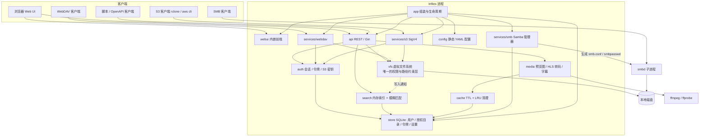

# LocalNetwork Files

局域网文件管理系统：把服务器上的若干目录按用户授权，通过 **Web 界面、WebDAV、S3、SMB** 和 **REST API**
访问与管理；内置视频实时转码串流（HLS，可任意拖动进度）、预览图生成与缓存生命周期管理、模糊搜索。

后端 Go（Gin）+ SQLite（纯 Go 驱动，无需 CGO），前端 Vue 3 + Naive UI，构建后打包成**单个可执行文件**。

## 功能

- **文件管理**：浏览（列表 / 网格视图）、新建文件夹、重命名、移动、复制、删除、下载；拖放 / 多文件上传队列（显示进度、冲突时可选择覆盖或跳过）。
- **在线预览**：图片、视频、音频、PDF、文本 / 代码（可直接编辑保存）；视频支持多音轨与内嵌 / 外挂字幕（转换为 WebVTT）。
- **实时转码串流**：浏览器无法直接播放的视频（MKV、HEVC、AVI…）通过 ffmpeg 实时转为 HLS，**分片按需生成，可随意拖动进度**；支持 原画 / 1080p / 720p / 480p 清晰度和硬件编码。
- **预览图**：图片与视频封面自动生成缩略图（多种尺寸），保存在缓存目录。
- **缓存周期管理**：预览图和转码分片分别设置保留时长（按最后访问时间计算）与容量上限（超出时按 LRU 淘汰），定时清理，管理界面可查看占用并手动清理。
- **用户与权限**：管理员为每个用户授权服务器上的目录，并分别设置**只读 / 可读写**；所有协议共用同一套权限检查。
- **OpenAPI 访问令牌**：用户可创建带 `read` / `write` 权限范围和有效期的 API 令牌（`lnf_` 前缀），界面内置交互式 API 文档（`/api/openapi.json`）。
- **深色模式**：跟随系统 / 浅色 / 深色，桌面与移动端自适应布局。
- **协议服务与挂载**：WebDAV（与 Web 共用端口 `/dav`）、S3 兼容接口（每个授权目录是一个 bucket）、SMB（托管 Samba）；「挂载」页面给出 Windows / macOS / Linux / rclone 等的现成命令。
- **模糊搜索**：常驻内存的文件名索引，fzf 风格的子序列匹配与打分（连续匹配、词首、驼峰、中英文边界加分），可按类型过滤，结果只包含当前用户有权访问的文件；文件变动通过写入通知、文件系统监听（Linux / Windows）和定时重建保持同步。

## 架构



要点：

- **vfs 是唯一的权限执行层**。REST、WebDAV、S3 都通过 `vfs.FS` 访问文件：虚拟路径 `/<授权目录名>/<相对路径>`
  映射到磁盘，拒绝 `..` 与跳出授权目录的符号链接，只读目录拒绝一切写操作。
- **SMB 例外**：权限由生成的 `smb.conf`（每个授权目录一个共享，`valid users` / `write list`）交给 Samba 执行。
- **配置分两层**：`config.yaml` 只放启动参数；缓存、转码、搜索、服务开关等运行时选项保存在数据库，管理界面修改后立即生效。
- **store 事件**：用户 / 授权目录或设置变化时，搜索索引根目录、S3 监听端口、Samba 配置会自动刷新。

## 目录结构

```
.
├── README.md
├── .github/workflows/ci.yml   # CI：go vet / test，前端类型检查与构建
├── server/                    # Go 后端（模块 github.com/Sakana-1314/LocalNetwork-Files/server）
│   ├── cmd/lnfiles/           # main 入口
│   ├── internal/
│   │   ├── config/            # YAML 静态配置 + 环境变量
│   │   ├── store/             # GORM + SQLite：模型、运行时设置、变更事件
│   │   ├── auth/              # 密码、会话 JWT、API 令牌、S3 密钥（加密保存）、Basic 认证
│   │   ├── vfs/               # 每用户虚拟文件系统（权限与路径约束）
│   │   ├── search/            # 文件名索引、模糊匹配、文件系统监听
│   │   ├── media/             # ffprobe 探测、预览图、HLS 转码、音频流、字幕
│   │   ├── cache/             # 缓存目录布局与生命周期
│   │   ├── services/{webdav,s3,smb}/
│   │   ├── api/               # REST 接口 + openapi.yaml
│   │   ├── app/               # 组装各子系统、HTTP 服务、优雅退出
│   │   └── webui/             # go:embed 前端构建产物（dist/）
│   ├── deploy/                # systemd unit、容器配置
│   ├── config.example.yaml
│   ├── Dockerfile
│   └── Makefile
└── web/                       # Vue 3 + Naive UI 前端（Vite）
    └── src/
        ├── api/               # 类型化 API 客户端（对应 openapi.yaml）
        ├── stores/            # Pinia：会话、偏好（主题/视图）、上传队列
        ├── router/ layouts/ views/
        ├── components/        # files / preview / admin / apidocs / common
        ├── composables/ utils/
        └── styles/
```

## 快速开始

### 环境要求

| 依赖 | 用途 |
| --- | --- |
| Go（版本见 `server/go.mod` 的 `go` 指令） | 编译后端 |
| Node.js 20.19+ / 22.12+、pnpm 10 | 构建前端（Vite 8） |
| ffmpeg、ffprobe（可选） | 视频预览图、实时转码、音频 / 字幕转换；缺失时这些功能自动禁用 |
| Samba（可选，仅 Linux） | SMB 服务 |

### 编译与运行

```bash
cd server
make all          # = make web（pnpm install && pnpm build）+ make build，输出 bin/lnfiles
cp config.example.yaml config.yaml   # 按需修改
make run          # 或 ./bin/lnfiles -config config.yaml
```

浏览器打开 `http://<服务器IP>:8080`。

其它 Make 目标：`make test`（`go test -race ./...`）、`make vet`、`make dist`（交叉编译 linux/amd64、linux/arm64、darwin/arm64、
windows/amd64 到 `bin/dist/`，`CGO_ENABLED=0`）、`make clean`。版本号取自 `git describe`，可用 `make build VERSION=1.2.3` 指定。

### 开发模式

```bash
# 终端 1：后端
cd server && go run ./cmd/lnfiles
# 终端 2：前端（热更新），/api 与 /dav 代理到 http://127.0.0.1:8080，可用 LNF_BACKEND 环境变量修改
cd web && pnpm install && pnpm dev
```

未构建前端时，后端仍可运行，首页会显示「前端尚未构建」的提示。

### Docker

构建上下文是仓库根目录：

```bash
docker build -f server/Dockerfile -t lnfiles .
docker run -d --name lnfiles \
  -p 8080:8080 -p 9000:9000 -p 445:445 \
  -v lnfiles-data:/data \
  -v /srv/media:/media \
  lnfiles
```

镜像基于 debian-slim，已包含 ffmpeg 与 Samba，内置配置见 `server/deploy/config.docker.yaml`
（数据目录 `/data`，SMB 自动创建系统账户）。在管理界面把 `/media` 下的目录授权给用户即可。

### systemd

```bash
sudo install -Dm755 server/bin/lnfiles /usr/local/bin/lnfiles
sudo install -Dm640 server/config.example.yaml /etc/lnfiles/config.yaml
sudo install -Dm644 server/deploy/lnfiles.service /etc/systemd/system/lnfiles.service
sudo systemctl daemon-reload && sudo systemctl enable --now lnfiles
```

数据保存在 `/var/lib/lnfiles`。

## 配置

完整说明见 [`server/config.example.yaml`](server/config.example.yaml)。主要项：

| 配置 | 默认值 | 说明 |
| --- | --- | --- |
| `listen` | `:8080` | Web / API / WebDAV 监听地址（环境变量 `LNF_LISTEN`） |
| `data_dir` | `./data` | 数据库、密钥、Samba 状态（环境变量 `LNF_DATA_DIR`） |
| `cache_dir` | `<data_dir>/cache` | 预览图与转码分片 |
| `ffmpeg` / `ffprobe` | `ffmpeg` / `ffprobe` | 可执行文件路径 |
| `session_ttl` | `168h` | 网页登录有效期 |
| `admin.username` / `admin.password` | `admin` / `admin123` | 初始管理员，仅在没有任何用户时创建 |
| `smb.*` | | smbd / smbpasswd 路径、自动创建系统账户、账户名前缀、force user |
| `log_level` | `info` | debug / info / warn / error |

运行时选项（缓存保留时长与容量、转码编码器 / 预设 / 并发 / 分片时长、搜索重建间隔与监听、WebDAV / S3 / SMB 开关与端口）
在管理界面「系统设置」中修改。

## 首次登录

1. 使用 `admin` / `admin123` 登录（或配置文件中的初始账户）。
2. **立即在「设置 → 账户」中修改密码。**
3. 在「用户管理」中创建用户，为其选择服务器目录、设置只读或可读写。管理员自己也需要授权目录后才能看到文件。

## 挂载指南

登录后打开「挂载」页面，会按当前用户、服务器地址和端口生成可直接复制的命令。概要如下。

### WebDAV

- 地址：`http://<服务器>:8080/dav/`，用户名 + 登录密码；密码处也可以填写 API 访问令牌（只读令牌即只读挂载）。
- macOS Finder：「前往 → 连接服务器」输入上述地址；Linux：davfs2 或 `rclone`。
- **Windows**：资源管理器默认只允许 HTTPS 上的 Basic 认证。通过 HTTP 访问需修改注册表后重启 WebClient 服务：

  ```bat
  reg add HKLM\SYSTEM\CurrentControlSet\Services\WebClient\Parameters /v BasicAuthLevel /t REG_DWORD /d 2 /f
  net stop webclient && net start webclient
  net use Z: http://<服务器>:8080/dav/ /user:<用户名> *
  ```

  WebClient 默认限制单文件 50 MB，可调整同一位置的 `FileSizeLimitInBytes`。

### SMB

- 由本程序托管一个独立的 Samba `smbd` 进程（使用 `<data_dir>/samba/` 下生成的 `smb.conf` 与密码库，不影响系统已有的 Samba 配置）。
  **需要 Linux + Samba，并以 root 运行**（监听 445 端口、切换到用户身份）。macOS 自带的 smbd 不是 Samba，无法使用；不支持 Windows。
- 在「系统设置 → 服务」中开启，可修改端口与工作组。每个授权目录是一个共享；同名但指向不同目录的共享会自动加上 `-用户名` 后缀，
  「挂载」页面会显示实际的共享名。
- Samba 只能认证系统账户：开启 `smb.create_system_users`（自动创建 nologin 账户）或手动创建同名系统账户；
  可用 `smb.user_prefix` 避免与已有系统账户冲突（开启自动创建时，不会复用 uid < 1000 的系统账户，也不会映射到 root）。
- Samba 需要明文密码才能生成其哈希，因此 **开启 SMB 后，用户需要重新登录一次（或修改密码）**，密码才会同步到 Samba。
- Windows 资源管理器只能连接 445 端口。

### S3

- 端点：`http://<服务器>:9000`（端口可在管理界面修改），区域默认 `us-east-1`，使用 path-style 访问。
- 在「设置 → S3 密钥」中创建 Access Key / Secret Key（可设为只读）。**每个授权目录是一个 bucket**，名称即目录名。
  S3 客户端普遍要求 bucket 名为小写 ASCII，**建议授权目录名使用英文小写字母、数字和 `-`**。
- 支持：ListBuckets、ListObjects(V1/V2)、Get/Head/Put/Copy/Delete Object、批量删除、分片上传。

```bash
# aws cli
aws configure set aws_access_key_id <AK>
aws configure set aws_secret_access_key <SK>
aws --endpoint-url http://192.168.1.10:9000 s3 ls
aws --endpoint-url http://192.168.1.10:9000 s3 cp ./a.mp4 s3://movies/2024/a.mp4

# rclone (~/.config/rclone/rclone.conf)
[lnfiles]
type = s3
provider = Other
access_key_id = <AK>
secret_access_key = <SK>
endpoint = http://192.168.1.10:9000
force_path_style = true

rclone ls lnfiles:movies
rclone mount lnfiles:movies /mnt/movies --vfs-cache-mode writes
```

## OpenAPI

- 规范：`GET /api/openapi.json`（源文件 `server/internal/api/openapi.yaml`），界面「API 文档」页面可交互浏览。
- 认证：`Authorization: Bearer <token>`，token 可以是登录得到的会话令牌，或「设置 → 访问令牌」中创建的 API 令牌；
  无法设置请求头的场景（`<video>`、HLS）可用查询参数 `access_token=`。缺少 `write` 权限范围的令牌只能执行只读操作。
- 虚拟路径：`/` 下一级是授权目录名，例如 `/movies/2024/a.mkv`。

```bash
TOKEN=lnf_xxxxxxxx   # 在「设置 → 访问令牌」中创建
H="Authorization: Bearer $TOKEN"
BASE=http://192.168.1.10:8080/api/v1

curl -H "$H" "$BASE/fs/list?path=/movies"                                   # 列目录
curl -H "$H" -G "$BASE/fs/search" --data-urlencode "q=avengers" -d kind=video  # 模糊搜索
curl -H "$H" -o a.mkv -G "$BASE/fs/raw" --data-urlencode "path=/movies/a.mkv"  # 下载（支持 Range）
curl -H "$H" -T notes.txt "$BASE/fs/file?path=/docs/notes.txt&overwrite=true"  # 上传 / 覆盖
curl -H "$H" -H 'Content-Type: application/json' -d '{"path":"/docs/new"}' "$BASE/fs/mkdir"

# 也可以用账号密码换取会话令牌
curl -H 'Content-Type: application/json' -d '{"username":"alice","password":"..."}' "$BASE/auth/login"
```

## 视频转码

- 播放时先用 ffprobe 探测；浏览器可直接播放的格式直接串流原文件（支持 Range），否则调用 `POST /media/transcode` 创建转码会话。
- 会话立即返回一个**完整的 VOD 播放列表**（分片数由时长计算），播放器因此可以拖动到任意位置。分片**按需生成**：
  请求的分片既不在磁盘上、也不在当前 ffmpeg 即将产出的范围内时，ffmpeg 会从该分片的时间点重新开始转码。
  关键帧强制对齐分片边界，不同次运行产出的分片可以无缝拼接。一段时间没有请求时 ffmpeg 自动停止。
- 编码器在「系统设置 → 转码」中选择：`libx264`（软件）、`h264_videotoolbox`（macOS）、`h264_nvenc`（NVIDIA）、
  `h264_qsv`（Intel）、`h264_vaapi`（Linux VA-API，`/dev/dri/renderD128`）。硬件编码失败时自动回退到 libx264。
  另可设置预设、最大并发转码数、分片时长。
- 已生成的分片保存在 `<cache_dir>` 的转码桶中，同一文件 / 清晰度 / 音轨再次播放直接复用；按「转码缓存」的保留时长与容量上限清理，
  正在播放的会话不会被清理。预览图使用独立的缓存桶与清理策略。

## 安全说明

- 设计用于**可信局域网**，服务本身只提供 HTTP。需要跨网络访问时请放在 HTTPS 反向代理（Caddy、Nginx 等）之后，
  或使用 VPN；WebDAV / S3 / SMB 的凭据在 HTTP 上是可被嗅探的。
- 首次登录后务必修改 `admin` 默认密码；登录接口对同一 IP 有失败次数限制。
- 用户只能访问被授权的目录，路径穿越与指向授权目录外的符号链接会被拒绝；只读授权对所有协议生效。
- API 令牌与 S3 密钥可随时吊销；API 令牌只保存哈希，S3 Secret 使用服务器密钥加密保存（Secret 只在创建时显示一次）。
- `data_dir` 中包含数据库与签名密钥，请限制其访问权限并纳入备份。
- SMB 需要 root；如不使用 SMB，可以用普通用户运行（见 `server/deploy/lnfiles.service` 中的说明）。

## 许可

见 LICENSE（如有）。
