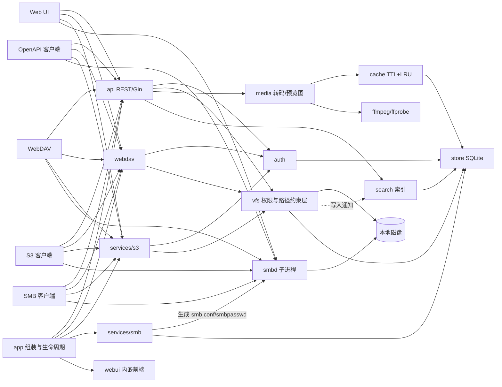

# 架构

## 关键设计

- **vfs 是唯一的权限执行层**：REST、WebDAV、S3 都通过 `vfs.FS` 访问文件，拒绝 `..` 与跳出桶目录的
  符号链接，只读目录拒绝一切写操作。SMB 例外，权限由生成的 `smb.conf` 交给 Samba 执行。
- **配置只有一层**：包括服务开关、转码、缓存、搜索在内的全部选项都在 `config.yaml`，重启生效。
- **store 事件**：用户 / 授权桶 / 桶变化时，搜索索引根目录与 Samba 配置自动刷新。

## 桶与备份

桶是对服务器目录的抽象，可指定多个目录互为备份（复制而非软链接），第一个可用目录为主目录。

- 通过 Web / WebDAV / S3 的写入会同步复制到其余目录。
- SMB 或直接在磁盘上的改动、目录离线期间的变化，由每 30 分钟一次（也可在「系统管理」手动触发）
  的合并补齐。合并只增不删、以最新修改的副本为准。
- 创建桶或新增目录时会先合并已有内容，同一路径在不同目录中内容不同则拒绝并列出冲突。

## 目录结构

| 目录 | 内容 |
| --- | --- |
| `server/` | 后端（Go + Gin + SQLite），含 `internal/api/openapi.json` 规范与 `internal/webui/` 内嵌前端产物 |
| `web/` | 前端（Vue 3 + TypeScript + Naive UI） |
| `docs/` | 本文档站（VitePress） |
| `.github/workflows/` | CI/CD 工作流 |

各包职责见
[`server/README.md`](https://github.com/Sakana-1314/MList/blob/main/server/README.md) 与
[`web/README.md`](https://github.com/Sakana-1314/MList/blob/main/web/README.md)。
